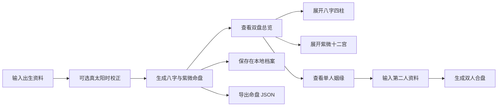
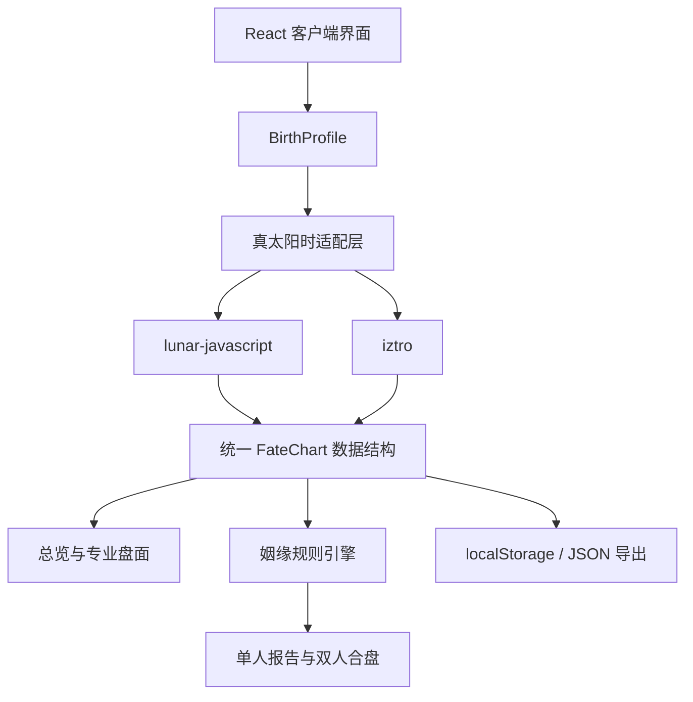

# Cyberfate 产品与技术设计文档

> 文档版本：1.0  
> 对应产品版本：Cyberfate 1.0.0
> 核对日期：2026-11-20  
> 文档性质：产品设计、技术架构、规则口径与参考来源的统一说明

## 1. 文档目的

本文档回答四个问题：

1. Cyberfate 解决什么问题，当前有哪些主要功能；
2. 产品如何计算命盘，技术和开源能力来自哪里；
3. 八字、紫微和姻缘模块分别采用了哪些传统规则；
4. 为什么产品采用当前的信息架构、交互方式和视觉表达。

本文档同时划清三类内容的边界：

- **可复现计算**：历法转换、真太阳时校正、四柱与紫微排盘；
- **传统规则解释**：夫妻宫、配偶星、桃花、合冲等术数规则；
- **产品表达**：页面结构、视觉层级、提示文案和风险说明。

“计算结果可复现”只表示相同输入与算法版本会得到相同输出，不表示命理结论已经得到现代科学验证。

## 2. 产品定义

### 2.1 一句话定位

Cyberfate 是一个强调**本地计算、规则可追溯和克制表达**的中文传统术数工作台。

### 2.2 产品目标

- 将出生日期、时间、性别与经度转化为结构化的八字和紫微命盘；
- 把排盘依据、解释规则与界面文案分层，避免把生成结果包装成不可解释的“神谕”；
- 为普通用户提供易读的总览，为研究型用户保留四柱、十二宫、星曜和规则证据；
- 出生资料默认只在浏览器内处理，不建立服务端用户画像；
- 围绕运限、现实观测与复盘继续深化；当前不扩张六爻、奇门和风水门类。可选 AI 仅作为有来源、可关闭的语言整理层。

### 2.3 非目标

当前产品不试图：

- 证明八字或紫微斗数具有科学预测效力；
- 替用户作出婚姻、医疗、法律、投资或职业决定；
- 用一个“匹配分”概括两个人的真实关系；
- 在缺少规则和算法时随机生成六爻、奇门或风水结论；
- 收集出生资料用于广告、画像或模型训练。

## 3. 用户与核心场景

### 3.1 主要用户

- **文化兴趣用户**：希望了解自己的八字、紫微盘和关系线索；
- **伴侣或关系观察者**：希望比较双方命盘，但不希望被简单判定“合”或“不合”；
- **术数学习者**：关注排盘口径、星曜宫位、十神、藏干和规则依据；
- **开发与研究人员**：需要结构化 JSON、开源库来源和可复现的计算链路。

### 3.2 核心使用路径



## 4. 当前主要功能

### 4.1 出生资料与时间校正

- 档案名称；
- 公历出生日期和出生时间；
- 男命或女命；
- 出生地东经，经度输入范围当前为 73°–135°；
- 真太阳时开关；
- 校正分钟数与校正后时辰预览；
- 自定义日期、时间选择器，整块字段可点击，不依赖浏览器原生日历图标。

### 4.2 综合总览

- 出生档案摘要；
- 八字四柱骨架；
- 表层五行数量；
- 紫微命宫、命主、身主、五行局；
- 生肖与星座；
- 五条规则生成的优先观察点，并明确标注“非 AI”；
- 每条观察可展开查看盘面依据、替代解释、当前未纳入因素与专业页面入口；
- 单独列出本次导读已经覆盖和仍未覆盖的规则范围。

### 4.3 子平八字

- 年柱、月柱、日柱、时柱；
- 天干、地支、藏干；
- 天干十神与地支十神；
- 纳音、十二长生；
- 命宫、身宫、胎元、旬空；
- 四柱天干与地支的表层五行计数；
- 日支六合、六冲摘要与阅读顺序导引；
- 移动端使用逐柱展开卡片，桌面端保留横向四柱表格。

当前五行图只统计四个天干与四个地支，共八个表层字符；它不计算藏干权重、月令旺衰、透干、根气、合化或调候，因此不能被称为完整的“八字强弱分析”。

### 4.4 紫微斗数

- 本命十二宫；
- 主星、辅星、杂曜；
- 星曜亮度与四化字段；
- 命宫、身宫、来因宫标识；
- 命主、身主、五行局；
- 十二长生与大限年龄区间；
- 命身轴与本命四化导读；
- 移动端使用逐宫浏览器，桌面端保留完整十二宫方盘。

当前页面展示本命盘，不提供完整的大限、流年、流月叠盘解释。

### 4.5 时运六象

- 从当年起连续计算六个流年；
- 比较流年天干与日主五行的同气、生扶、耗泄和制约；
- 比较流年地支与日支、原局其余地支的六合与六冲；
- 观察原局表层是否具备对应流年五行；
- 分别记录助势、制约、动象和耗势四类规则计数；
- 依据规则组合输出得时乘势、守正慎行、动象已彰、气弱待时、吉凶相参或象静无征；
- 每年均可展开盘面信号、反向提醒和现实观测建议。

六象不是从“大吉”到“大凶”的等级，也不是概率或总分。例如“动象已彰”只表示合冲等变化规则集中，既可能对应压力，也可能对应迁移、转型或关系推进。

### 4.6 单人姻缘

- 以八字日支作为“夫妻宫”坐标；
- 按性别取配偶星五行：男命取财星，女命取官杀；
- 以日支所属三合局查咸池桃花；
- 观察日支与其余地支的六合、六冲；
- 展示紫微夫妻宫的干支和主星；
- 生成未来五年的“活跃、转折、平稳”规则标签；
- 每条结果同时显示规则证据、替代解释、未纳入因素和现实核对问题；
- 用户可逐年标记“有对应经历、暂无对应经历、仍不确定”，并补充文本记录；
- 年度记录只写入当前浏览器，可逐年清除，不回流到规则计算。

“活跃”不等于必然恋爱或结婚，“转折”也不等于分手。时间线只表示当前规则检测到了较明显的传统术数触发条件。

### 4.7 双人合盘

合盘比较双方日柱、日主五行、夫妻宫、配偶星和未来五年的触发窗口，输出五个可解释维度：

- 吸引机制；
- 沟通节奏；
- 冲突触发；
- 长期结构；
- 时间协调。

产品刻意不设置总匹配分。关系是多维、动态且受现实条件影响的，单一分数会制造并不存在的测量精度。
每个维度另附一个现实讨论问题和本次规则的计算边界，用来把盘面标签转回双方可沟通、可核对的具体议题。
关系摘要与分享卡默认使用 A/B 代称，不包含姓名、生辰、城市或经度；分享前提供内容预览，并提醒取得对方知情。

### 4.8 上下文术语词典

- 八字页解释日主、十神、藏干、月令、六合 / 六冲和纳音；
- 紫微页解释命宫、身宫、空宫、三方四正、四化和大限；
- 姻缘页解释夫妻宫、配偶星、桃花位、流年触发和合盘；
- 时运页解释时、位、势、象、生扶 / 制约与岁运；
- 每个词条同时给出简短定义、补充说明和使用边界；
- 桌面端使用分栏词条，移动端保持单列、逐项展开。

### 4.9 本地档案与导出

- 最近生成的档案保存在浏览器 `localStorage`；
- 当前最多保留 8 条记录；
- 可重新载入历史档案；
- 单条删除时明确区分“仅删除档案”和“档案及关联观测/关系复盘”；另提供清空档案列表与清除全部 Cyberfate 本地数据；
- 可将完整命盘导出为 JSON；
- 命盘和完整备份在下载前明确展示所含敏感字段；完整备份包含档案、观测与关系年份复盘；
- 修改出生资料后，旧结果标记为“待更新”，重新生成前禁止导出、分享或基于旧结果新增观察；
- 当前没有数据库、账号系统或主动上传逻辑。

## 5. 功能状态与路线

### 5.1 已实现

- 真太阳时基础校正；
- 八字四柱与基础结构数据；
- 紫微本命十二宫；
- 单人姻缘与双人合盘；
- 本地档案与 JSON 导出；
- 桌面端和移动端响应式布局。

### 5.2 已规划但未实现

- 大限流年四化叠盘与完整三方四正会照权重；
- 化气后的旺衰重估与更完整的藏干权重；
- 人工复核金标准盘、跨库对照和端到端 UI 回归；
- 流派与口径配置；
- 可选的自带密钥 AI 解读。

未实现模块只展示路线状态，不生成占位结论。

## 6. 技术架构

### 6.1 总体架构



### 6.2 技术栈

当前锁定安装版本为：

- Next.js 16.4.6；
- React / React DOM 19.3.1；
- TypeScript 5.9.3；
- iztro 2.6.5；
- lunar-javascript 1.7.8；
- 原生 CSS 视觉系统。

`package.json` 使用兼容版本范围，`package-lock.json` 负责锁定实际安装版本。升级排盘库时必须运行金标准盘回归测试，不能只依赖类型检查。

### 6.3 前端结构

- `app/page.tsx`：单页入口；
- `components/CyberfateApp.tsx`：工作台状态、总览、八字、紫微和档案操作；
- `components/RelationshipView.tsx`：单人姻缘与双人合盘；
- `components/FortuneView.tsx`：时运六象、六年卡片与规则证据；
- `components/TerminologyPanel.tsx`：八字、紫微与关系共用的渐进式术语面板；
- `components/DateTimeField.tsx`：自定义日期和时间选择；
- `lib/engines.ts`：时间校正、八字和紫微计算适配层；
- `lib/insights.ts`：总览、八字与紫微的证据导读规则；
- `lib/fortune.ts`：流年规则计数、六象分类与反向提醒；
- `lib/relationship.ts`：关系规则与解释文本；
- `lib/glossary.ts`：上下文术语、定义和使用边界；
- `lib/types.ts`：跨模块统一类型；
- `app/globals.css`：布局、颜色、排版和响应式样式。

页面外壳可以在构建时预渲染；出生资料计算、历史档案和交互状态在客户端完成。Next.js App Router 的官方说明见[参考 R4](#r4)。

### 6.4 数据模型

核心输入 `BirthProfile` 包含：档案 ID、名称、日期、时间、性别、经度、真太阳时开关和创建时间。

核心输出 `FateChart` 包含：

- 原始出生档案；
- 校正后的日期时间与校正明细；
- 标准化八字数据；
- 标准化紫微数据。

统一数据模型隔离了第三方库的原始对象，使界面和关系规则不会直接绑定某个库的全部 API。

## 7. 计算口径与理论依据

### 7.1 真太阳时

中国标准时间采用 UTC+8，理论时区中央经线为东经 120°。中国科学院的科普资料说明，经度每差 1°，地方时相差约 4 分钟[参考 R8](#r8)；NOAA 的太阳位置计算也使用 `4 × longitude` 的分钟偏移项[参考 R7](#r7)。

当前实现为：

```text
真太阳时 = 钟表时间 + 经度修正 + 均时差
经度修正 = 4 ×（出生地东经 − 120°）分钟
```

均时差使用常见工程近似：

```text
B = 360 / 365 ×（年内日序 − 81）
E = 9.87 sin(2B) − 7.53 cos(B) − 1.5 sin(B)
```

相同形式的近似式可见劳伦斯伯克利国家实验室相关论文附录[参考 R9](#r9)。NOAA 提供了包含分数年项的另一套近似式，适合后续作为精度升级与交叉验证基准[参考 R7](#r7)。

当前限制：

- 只输入经度，不输入纬度；当前校正本身也只需要经度和日期；
- 没有出生地城市、历史时区或夏令时数据库；
- 默认语境是中国标准时间，海外出生不能仅靠经度正确还原钟表时间；
- 出生钟表时间以无设备时区的民用字段处理，UTC 时间戳只作为跨日加减分钟的算术载体；跨上海、纽约、伦敦设备时区的完整命盘矩阵测试要求结果一致；
- 公式是分钟级近似，不是高精度天文历算。

### 7.2 八字排盘

八字数据由 `lunar-javascript` 生成。该库公开支持公历、农历、干支、节气、八字、五行、十神、纳音等数据[参考 R2](#r2)。

本项目调用路径为：

```text
校正后的公历时刻
→ Solar.fromYmdHms
→ Lunar
→ EightChar
→ 年、月、日、时四柱及附属数据
```

项目设置 `sect = 2` 处理晚子时口径，并依赖库按节气确定月柱。不同流派对年界、晚子时换日、闰月和真太阳时存在不同约定，后续应把这些约定做成可见配置，而不是隐藏为唯一答案。

### 7.3 紫微斗数排盘

紫微数据由 `iztro` 的太阳历排盘 API 生成。该项目是 MIT 许可的 JavaScript 紫微斗数排盘库，提供十二宫、星曜、四化、运限和相关类型[参考 R1](#r1)。

当前调用口径：

```text
astro.bySolar(校正后公历日期, 时辰索引, 性别, fixLeap=true, "zh-CN")
```

项目将返回值归一化为十二宫、主辅杂曜、亮度、四化、命身主、五行局、十二长生和大限区间。

紫微流派众多，星曜亮度、四化、闰月和部分安星规则可能存在差异。iztro 本身也提供配置和插件机制以适应不同流派[参考 R1](#r1)。因此产品后续需要展示“算法版本 + 流派口径”，不能只显示一个无来源的结果。

### 7.4 时运六象规则

当前六象是透明的流年表层规则，不是统计模型。每一年分别累计四类信号：

- **助势**：流年生扶日主、同气、与日支或原局六合；
- **制约**：流年五行制日主、与日支或原局六冲；
- **动象**：六合、六冲或流年地支与日支同位；
- **耗势**：日主生流年、日主所克之气需要投入，或原局表层缺少对应五行承接。

分类首先识别支持与制约并存的“吉凶相参”，再识别强变化、强制约、资源不足和集中助势；没有形成集中信号时显示“象静无征”。计数只表示规则命中数量，不代表成功率、风险概率或真实事件强度。

当前未纳入大运、流月流日、月令旺衰、藏干权重、刑害破以及紫微大限与四化飞星，因此不能称为完整的吉凶祸福判断。

### 7.5 单人姻缘规则

当前规则是一个透明、有限的规则集合，不是统计学习模型：

1. **夫妻宫**：以八字日支作为关系观察坐标；
2. **配偶星**：男命以日主所克五行为财星，女命以克日主五行为官杀；《三命通会》卷七可见“我克者为财为妻、克我者为官”等传统六亲取法[参考 R10](#r10)；
3. **桃花**：按日支三合局查咸池，当前映射为申子辰见酉、寅午戌见卯、亥卯未见子、巳酉丑见午；
4. **合冲**：检查日支与其余地支的六合、六冲；
5. **紫微夫妻宫**：读取夫妻宫主星；iztro 的宫位资料强调夫妻宫用于观察关系态度，且不能脱离全盘单宫论断[参考 R11](#r11)；
6. **未来五年**：检查流年桃花、流年与日支六合/六冲、流年天干是否出现配偶星五行。

时间线等级是规则标签：

- “活跃”：桃花或六合等支持性触发达到阈值；
- “转折”：流年六冲触发达到阈值；
- “平稳”：没有检测到表层强触发。

当前算法没有纳入大运、流月、藏干权重、月令旺衰、刑害破、完整三方四正或现实事件数据，所以只能称为“表层结构观察”。

### 7.6 双人合盘规则

当前合盘主要检查：

- 双方日干五合；
- 双方日支六合或六冲；
- 双方日主五行同类、相生或相克；
- 一方命盘表层是否出现另一方规则所取的配偶星五行；
- 未来五年双方非“平稳”年份是否重合。

输出采用“协同、互补、中性、需经营”四类描述，不计算概率，也不声称因果关系。合盘结果必须与现实中的价值观、责任分配、沟通方式、安全边界和人生阶段共同理解。

### 7.7 科学边界

八字与紫微斗数属于传统文化和术数体系，目前没有被本项目用现代科学方法验证。1985 年发表于《Nature》的双盲研究检验了出生星盘与人格判断的对应关系，实验结果未支持其预测假设[参考 R12](#r12)。该研究并非对八字或紫微斗数的直接实验，不能简单替代针对中国术数的独立验证；但它说明，任何预测性主张都需要可重复、可对照的证据。

因此 Cyberfate 的产品口径是：

- 可以陈述“传统规则如何计算”；
- 不陈述“传统规则已被科学证实”；
- 不用命盘结果诊断疾病、决定投资或替代关系沟通；
- 不用确定性语言描述尚未发生的人生事件。

## 8. 产品与交互设计理论

### 8.1 “观测仪器”而非“自动判词机”

界面采用工作台和观测仪器的隐喻：出生资料是坐标，命盘是结构，解读是带证据的观察。这样可以减少“按钮一按就宣布命运”的戏剧化暗示。

对应设计做法：

- 用“结构观察、线索、触发”代替“注定、必然、一定”；
- 每条姻缘结果保留 `evidence`；
- 结果页持续显示免责声明和规则来源；
- 未完成模块显示状态，不伪造内容。

### 8.2 算法与解读分离

排盘层只生成结构化数据，规则层根据明确条件生成有限文字，未来 AI 层只能基于前两层作语言整理，并明确标注模型与提示来源。

这个分层带来三项好处：

- 可以单独验证历法和排盘是否正确；
- 可以追踪某句话由哪条规则产生；
- 更换 AI 或关闭 AI 不会改变基础命盘。

如果后续引入 AI，应参考 NIST 对透明、可解释和可追溯性的要求[参考 R16](#r16)，至少记录模型版本、输入数据范围、生成时间和免责声明。

### 8.3 渐进披露

总览先展示命盘身份、四柱骨架和命宫主轴；专业细节分别放入八字、紫微和姻缘页面。渐进披露可以让初次用户先完成主要任务，再按需进入复杂功能，减少学习负担和误操作[参考 R13](#r13)。

当前实现把五类信息按需展开：盘面依据、替代解释、计算局限、现实核对问题和术语定义。移动端不另造一套内容体系，而是把相同信息转换为逐项展开的触控路径；桌面端则利用更大宽度并列呈现。这保证了多端语义一致，同时避免维护两份彼此漂移的规则文案。

### 8.4 识别优于记忆

日期、时间、性别、校正状态、当前视图和规则证据都直接可见，尽量不要求用户记住隐含命令。Nielsen 的可用性原则指出，界面应让用户识别选项，而不是依赖回忆[参考 R14](#r14)。

对应设计包括：

- 日期与时间使用带格式提示的可见控件；
- 图标旁保留文字标签；
- 标签页同时显示名称与用途；
- 结果直接附带“八字 · 日支”“紫微 · 夫妻宫”等来源。

### 8.5 Local-first 与隐私默认

出生日期和时间属于高敏感度个人资料。V1 不需要账号与多人协作，因此采用本地优先：计算在浏览器完成，档案存入当前来源的 `localStorage`，导出由用户主动触发。

Local-first 研究强调用户对数据的所有权、离线能力和长期控制[参考 R15](#r15)；隐私保护设计也要求在设计阶段贯彻数据最小化和目的限制[参考 R18](#r18)。

需要明确的边界：

- `localStorage` 是同源持久存储，不是加密保险箱；其行为和隐私窗口限制见 MDN[参考 R6](#r6)；
- 共用设备上的其他使用者可能访问浏览器档案；
- 关系年度笔记同样保存在 `localStorage`，不是加密日记；
- 如果未来增加云同步，必须重新做同意、加密、保留期和删除机制设计。

### 8.6 视觉设计原则

视觉方向是“东方历法档案室 + 现代观测台”，而不是常见的金色神秘主义模板。

- **深青黑背景**：形成稳定、低刺激的工作台环境；
- **玉色与朱砂色**：分别承担结构支持与显著信号，不作为吉凶绝对标签；
- **宋体式标题与无衬线正文**：标题建立文化语境，正文保障可读性；
- **网格、圆轨和宫位卡片**：表达坐标、周期和结构关系；
- **克制动效**：只用于状态反馈，不用持续闪烁制造“灵验感”；
- **信息密度分层**：总览疏、专业盘面密，避免所有内容同时争夺注意力。

### 8.7 可访问性原则

产品以 WCAG 2.2 为后续验收基准[参考 R17](#r17)，重点包括：

- 文字与背景对比度；
- 键盘可操作和清晰焦点；
- 不仅依靠颜色表达状态；
- 足够大的点击目标；
- 标签页、表格、表单和弹层的语义；
- 支持减少动态效果；
- 移动端不出现不可达控件。

当前已经使用表单标签、按钮、`role=tablist`、`aria-selected` 等基础语义，但尚未完成系统化无障碍审计。

文字系统采用分层而非等比例放大：正文与解释文本主要使用 13–15px，元数据、状态和辅助标签不低于 11px；深色背景上的次级文字使用更高对比度灰色。表单字段和主要分段控件的高度不低于 44px。日期与时间在窄桌面侧栏中改为纵向排列，在移动端拥有足够宽度时恢复并排，从而兼顾字号与信息密度。

## 9. 技术参考与来源分级

### 9.1 运行时直接依赖

- `iztro`：紫微斗数排盘；
- `lunar-javascript`：公农历、干支、八字及附属数据；
- Next.js、React、TypeScript：应用框架、交互和类型系统。

### 9.2 产品与领域研究参考

项目早期研究了 [Renhuai123/ziwei-doushu](https://github.com/Renhuai123/ziwei-doushu)。该仓库对开源排盘、真太阳时、流派配置、回归测试、算法与解读边界等问题提供了重要参考。

当前 Cyberfate 的运行时代码不依赖该仓库；研究快照位于 `.research-ziwei-doushu`，并已从 TypeScript 编译范围排除。若未来复制其代码、数据集或文档，必须分别核对 MIT、CC BY 4.0、CC BY-NC-SA 等不同授权范围，不能把“仓库开源”等同于“全部内容可任意商用”。

### 9.3 传统理论来源

- 《三命通会》等传统命理文献：六亲、财官等术语来源；
- 《紫微斗数全书》及相关安星诀：紫微宫位和星曜的历史文本来源；
- iztro 知识文档：将传统概念与当前开源排盘 API 对齐。

传统文献用于说明规则的文化来源，不等于现代科学证据。

## 10. 隐私、安全与伦理

### 10.1 当前数据处理

- 输入：姓名或称呼、出生日期、出生时间、性别、经度；
- 处理位置：浏览器；
- 持久化：当前来源的 `localStorage`；
- 导出：用户主动下载 JSON；
- 服务端数据库：无；
- 第三方分析或广告 SDK：无。

### 10.2 风险与改进

- 持续验证档案、关联记录和全部本地数据三种删除范围的提示与回归测试；
- 在导出前提示 JSON 含出生资料；
- 若增加分享功能，默认脱敏姓名和精确时间；
- 若增加 AI，默认不发送完整身份字段，并向用户展示实际发送内容；
- 不为未成年人、医疗、投资或婚姻决定提供确定性建议；
- 对负面词汇、宿命化措辞和性别刻板印象建立内容审查规则。

## 11. 已知限制与技术债

1. 已有规则单元测试和固定命例回归检查，但仍缺人工复核的八字/紫微金标准盘、跨库对照和端到端 UI 回归；
2. 已内置 1986–1991 年中国夏令时还原规则，但尚无完整历史时区数据库，海外出生仍不支持；
3. 真太阳时公式为分钟级近似，尚未与 NOAA 算法做批量误差评估；
4. 八字和紫微的流派口径尚不可配置；
5. 五行统计只看表层八字；
6. 姻缘流年尚未纳入大运、流月和完整三方四正权重；
7. 双人合盘没有结构化现实关系问卷或行为数据；当前核对问题和年度笔记只供用户自我复盘，不进入评分或规则推断；
8. `localStorage` 无加密，不适合在不受信任的共用设备上保存敏感档案；
9. 尚未完成系统化 WCAG、性能、跨浏览器与移动端自动回归测试；
10. 项目根目录尚未设置自身 `LICENSE`，公开发布前需要确定代码授权。

## 12. 质量与验收原则

### 12.1 计算正确性

- 同一输入、同一版本必须得到相同输出；
- 对节气边界、23:00/00:00、闰年、跨日校正和极端经度建立测试；
- 为八字和紫微各维护一组人工复核的金标准盘；
- 升级依赖前后比较完整结构化 JSON，而不只比较页面截图。

### 12.2 可解释性

- 每条规则解读可定位到输入字段、盘面字段和规则条件；
- 页面区分“原始盘面”“规则解释”“未来 AI 文本”；
- 流派差异和不确定性不被隐藏；
- 不输出无法给出来源的确定性断语。

### 12.3 体验质量

- 日期和时间字段整块可点击、无闪烁；
- 桌面和移动端均无关键内容遮挡；
- 390px 手机、约 900px 中等窗口与 1440px 大屏均无水平滚动，并保持触控目标可达；
- 加载、成功、错误和空状态清晰；
- 视觉提示不只依赖颜色；
- 未完成模块不会误导为已可用。

### 12.4 隐私质量

- 未经主动操作不发出出生资料网络请求；
- 用户可以查看、导出和删除自己的本地资料；
- 新增任何第三方服务前更新数据流文档与隐私说明。

## 13. 下一阶段建议

建议按以下顺序推进：

1. 补齐人工复核金标准盘、跨库验证和关键用户路径回归；
2. 持续核验下载前隐私确认、A/B 分享预览与完整备份恢复；
3. 将时间口径、晚子时和紫微流派做成可见设置，并保持文档与实现同步；
4. 开展无障碍、移动端、跨浏览器和性能验收；
5. 完成大限流年四化叠盘与完整会照权重；
6. 最后再评估可选 AI，并保持算法数据与生成文本分层。

## 14. 参考资料

所有网络资料于 2026-11-20 核对。

### R1

[iztro GitHub 与官方文档](https://github.com/SylarLong/iztro)：紫微斗数排盘 API、配置、类型及 MIT 许可。

### R2

[lunar-javascript GitHub](https://github.com/6tail/lunar-javascript)：公农历、节气、干支、八字、五行、十神和纳音能力及 MIT 许可。

### R3

[React 官方文档](https://react.dev/)：组件、状态与客户端交互模型。

### R4

[Next.js App Router 官方文档](https://nextjs.org/docs/app)：应用路由、服务器与客户端组件、预渲染和部署方式。

### R5

[TypeScript 官方文档](https://www.typescriptlang.org/docs/)：静态类型与编译配置。

### R6

[MDN Web Storage API](https://developer.mozilla.org/en-US/docs/Web/API/Web_Storage_API)：`localStorage`、同源隔离、持久化和隐私模式行为。

### R7

[NOAA General Solar Position Calculations](https://www.gml.noaa.gov/grad/solcalc/solareqns.PDF)：均时差、经度、时区与真太阳时计算。

### R8

[中国科学院地理科学与资源研究所：如何划分地球的时区](https://igsnrr.cas.cn/cbkx/kpyd/dlzs/earth/202009/t20200910_5692488.html)：经度每度约 4 分钟及中国统一使用东八区标准时间。

### R9

[Lawrence Berkeley National Laboratory：BuildOpt 模型论文附录](https://eta-publications.lbl.gov/sites/default/files/mwdiss.pdf)：项目所用均时差近似式的同类工程表达。

### R10

[维基文库《三命通会》卷七](https://zh.wikisource.org/wiki/%E4%B8%89%E5%91%BD%E9%80%9A%E6%9C%83/%E5%8D%B7%E4%B8%83)：传统六亲与财官取法文本。

### R11

[iztro 紫微研习社：十二宫](https://docs.iztro.com/learn/palace)：夫妻宫、合盘和全盘综合观察的传统解释。

### R12

[Carlson, S. “A double-blind test of astrology”, Nature 318, 419–425 (1985)](https://doi.org/10.1038/318419a0)：出生星盘人格判断的双盲测试及科学边界参考。

### R13

[Nielsen Norman Group：Progressive Disclosure](https://www.nngroup.com/articles/progressive-disclosure/)：渐进披露设计原则。

### R14

[Nielsen Norman Group：Recognition and Recall](https://www.nngroup.com/articles/recognition-and-recall/)：识别优于记忆的界面原则。

### R15

[Kleppmann et al.：Local-first software](https://www.inkandswitch.com/essay/local-first/)：本地优先、数据所有权和用户控制。

### R16

[NIST AI Risk Management Framework 1.0](https://nvlpubs.nist.gov/nistpubs/ai/NIST.AI.100-1.pdf)：未来 AI 模块的透明、可解释、隐私与风险管理原则。

### R17

[W3C Web Content Accessibility Guidelines 2.2](https://www.w3.org/TR/WCAG22/)：网页可访问性验收基准。

### R18

[ICO：Data protection by design and by default](https://ico.org.uk/for-organisations/uk-gdpr-guidance-and-resources/accountability-and-governance/guide-to-accountability-and-governance/data-protection-by-design-and-by-default/)：隐私保护设计、数据最小化与目的限制。

## 15. 变更记录

- 2026-11-24：消除访问设备时区对出生时间、八字与紫微排盘的影响，新增上海/纽约/伦敦完整命盘一致性测试；补齐档案关联删除与全部本地数据清除闭环。
- 2026-11-20：增加关系证据抽屉、替代解释、现实核对、浏览器本地年度笔记与三类上下文术语词典；调整中等宽度合盘布局。
- 2026-11-20：完成全站文字可读性审计，提高正文、辅助标签和表单字号与对比度，并修复放大后日期字段的窄栏拥挤。
- 2026-11-20：新增“时运六象”，实现未来六年流年取象、四类规则计数、反向提醒、术语解释与桌面 / 移动端布局。
- 2026-11-20：建立 1.0 版，覆盖 V1 功能、架构、传统理论、设计原则、参考来源与科学边界。
